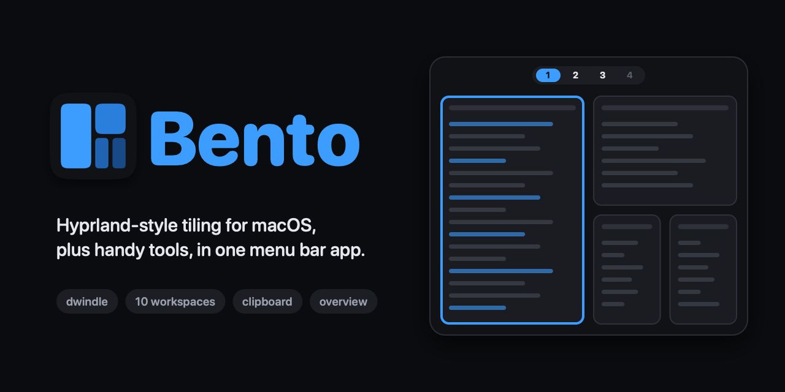

<div align="center">



**Hyprland-style tiling for macOS, plus handy tools, in one menu bar app.**

[**Download for macOS**](https://github.com/Amabeusz/bento/releases/latest/download/Bento.zip) · [Guide](docs/GUIDE.md) · [Releases](https://github.com/Amabeusz/bento/releases)


[](https://github.com/Amabeusz/bento/releases/latest)

</div>

https://github.com/user-attachments/assets/09425a3f-3d4d-4147-b4a4-97baea1c960e

Bento tiles your windows automatically, gives you 10 keyboard-driven workspaces and puts them on a small island under the menu bar. Next to the window manager it ships the tools you'd otherwise install separately: clipboard history, a window overview and Keep Awake.

## Features

- **Dwindle tiling** — every new window splits the space, no dragging and resizing by hand
- **10 workspaces** — switch with <kbd>⌃⌥</kbd> <kbd>1</kbd>…<kbd>9</kbd>, without macOS Spaces and without disabling SIP
- **Workspace island** — workspace numbers with app icons under the menu bar
- **Looks good** — gradient borders, smooth animations, gaps
- **Window overview** — every window on every display, on <kbd>F3</kbd>
- **Clipboard history** — text, images and files, with search and pinning; passwords are masked and never saved to disk
- **Keep Awake** — stop the Mac from sleeping, one click in the menu
- **Hyprland-style config** — a plain text file that reloads on save, or a Settings window if you prefer clicking
- **Multi-monitor** — the MacBook screen keeps workspace 0, the external monitor gets 1–9

## Installation

Requires macOS 26 or later on Apple Silicon.

1. Install with [Homebrew](https://brew.sh):

   ```bash
   brew install --cask amabeusz/bento/bento
   ```

   Or download [**Bento.zip**](https://github.com/Amabeusz/bento/releases/latest/download/Bento.zip), unzip it and move **Bento** to Applications.
2. Open Bento. The first launch is blocked — go to **System Settings → Privacy & Security** and click **Open Anyway**.
3. Grant the permissions below in the same pane. **Settings → Permissions** in Bento shows what is granted and opens the right place.

| Permission | What it enables | Without it |
|---|---|---|
| **Accessibility** | tiling, shortcuts, overview, pasting from clipboard history | clipboard history (copy only), Keep Awake and Settings still work |
| **Screen Recording** *(optional)* | animations, overview thumbnails | everything works, just without them |

> [!NOTE]
> Bento is not notarized by Apple, which is why step 2 is needed. After granting Screen Recording, quit Bento from its menu and open it again.

> [!WARNING]
> Quit other window managers (Rectangle, OmniWM, AeroSpace…) first — two of them fight over window positions. Keep **one macOS desktop (Space) per display**; Bento brings its own workspaces.

## Quick start

**mod** = <kbd>⌃ Control</kbd> + <kbd>⌥ Option</kbd>

| Shortcut | Action |
|---|---|
| <kbd>mod</kbd> <kbd>←</kbd> <kbd>→</kbd> <kbd>↑</kbd> <kbd>↓</kbd> (or <kbd>h</kbd> <kbd>j</kbd> <kbd>k</kbd> <kbd>l</kbd>) | focus a neighbouring window |
| <kbd>mod</kbd> <kbd>⇧</kbd> + arrows | move the window |
| <kbd>mod</kbd> <kbd>1</kbd>…<kbd>9</kbd> | go to a workspace |
| <kbd>mod</kbd> <kbd>⇧</kbd> <kbd>1</kbd>…<kbd>9</kbd> | send the window to a workspace |
| <kbd>mod</kbd> <kbd>F</kbd> | fill the screen |
| <kbd>mod</kbd> <kbd>V</kbd> | float / tile the window |
| <kbd>mod</kbd> <kbd>T</kbd> | split side by side / stacked |
| <kbd>mod</kbd> <kbd>-</kbd> <kbd>=</kbd> | shrink / grow |
| <kbd>mod</kbd> <kbd>Q</kbd> | close the window |
| <kbd>mod</kbd> <kbd>Return</kbd> | new terminal window |
| <kbd>mod</kbd> <kbd>Space</kbd> | command palette |
| <kbd>F3</kbd> or <kbd>⌃</kbd> <kbd>↑</kbd> | overview of all windows |
| <kbd>⇧</kbd> <kbd>⌘</kbd> <kbd>C</kbd> | clipboard history |
| <kbd>mod</kbd> + drag | move (left button) / resize (right button) |

All shortcuts, edge cases and the details of each feature are in the **[Guide](docs/GUIDE.md)**.

## Configuration

Open **Settings…** from the Bento menu (<kbd>⌘</kbd> <kbd>,</kbd>) for gaps, borders, the island, shortcuts and clipboard options.

Everything is also in `~/.config/bento/bento.conf`, written in Hyprland syntax. Changes apply a second after saving, and a typo shows up in the menu with its line number:

```ini
general {
    gaps_in = 10
    gaps_out = 12
    col.active_border = rgba(f5c2e7ff) rgba(89b4faff) 135deg
}

bind = $mod, b, focusorlaunch, Safari   # jump to Safari, or launch it
```

See the [configuration reference](docs/GUIDE.md#configuration) for every option.

## FAQ

<details>
<summary><b>Why does Bento need its own workspaces instead of macOS Spaces?</b></summary>

Controlling macOS Spaces from an app is slow and limited without disabling SIP. Bento hides windows of inactive workspaces just off-screen instead, which is instant and doesn't need SIP disabled. That's also why Mission Control shows windows of hidden workspaces as tiny tiles — use Bento's overview (<kbd>F3</kbd>) instead.
</details>

<details>
<summary><b>What happens to my windows when Bento quits or crashes?</b></summary>

On quit or pause every hidden window comes back on screen. After a crash they come back the next time Bento starts.
</details>

<details>
<summary><b>How does it work with an external monitor?</b></summary>

The MacBook screen keeps workspace 0 (<kbd>mod</kbd> <kbd>0</kbd>) and the monitor gets 1–9. Disconnect the monitor and its windows move over to the MacBook.
</details>

<details>
<summary><b>A settings or dialog window gets tiled. How do I make it float?</b></summary>

Most dialogs are detected and float on their own. For one that isn't, add a rule to `bento.conf`:

```ini
windowrule = float, app:^Calculator$
```
</details>

## Building from source

Needs Command Line Tools with Swift 6.2 (`xcode-select --install`), no Xcode.

```bash
scripts/build-app.sh && open build/bento.app
```

Create the `bento-dev` signing certificate first, or macOS will ask for permissions after every build — see [docs/SETUP.md](docs/SETUP.md), which also covers tests and releases.
